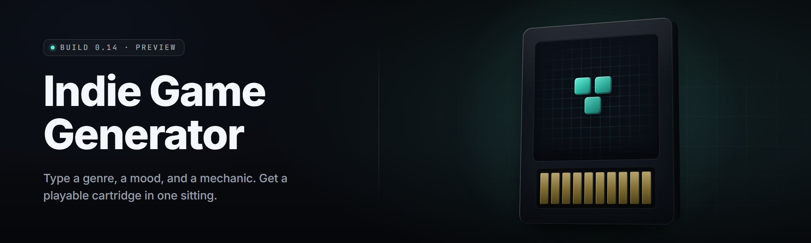

  
  
  

  

  
  

---

**AI full indie game generator for 2026** — prompt, generate, export. Full playable indie games from a text brief, local-first, ships every day.

---

## 🧭 Table of Contents

- [Quick Start](#-quick-start)
- [System Requirements](#-system-requirements)
- [Grouped Module Catalog](#-grouped-module-catalog)
- [Known Issues](#-known-issues)
- [FAQ](#-faq)
- [Overview](#-overview)
- [What is indie-game-ai-forge](#-what-is-indie-game-ai-forge)
- [Compatibility / Platform Support](#-compatibility--platform-support)
- [The Problem](#-the-problem)
- [All Modules Status](#-all-modules-status)
- [Key Features](#-key-features)
- [The Solution](#-the-solution)

---

## 🎮 Quick Start

1. 🧊 **Visit the project page** and grab the latest Windows build from the landing page.
2. 📦 **Extract** the archive to a folder you own — `C:\Games\indie-game-ai-forge\` works fine, no admin needed.
3. ⚙️ Run the `.exe` — first launch runs a one-time local model warm-up (60–90s on a mid GPU).
4. 💡 Type a brief in the **Forge Prompt** box: `"top-down roguelike, cyberpunk rats, 8-bit, 3 biomes"`.
5. 🏁 Hit **Generate** → preview window opens → **Export** to Godot, Unity, or a standalone build.

No pip. No npm. No git clone. Download, extract, run.

### ⬇️ Download

  

---

## 🧱 System Requirements

| Component | Minimum | Recommended |
|---|---|---|
| OS | Windows 10 21H2 | Windows 11 23H2 / Steam Deck (Proton 9) |
| CPU | 4-core x64, AVX2 | 8-core x64, AVX-512 |
| RAM | 16 GB | 32 GB |
| GPU | 6 GB VRAM (GTX 1660) | 12 GB VRAM (RTX 4070 / RX 7800) |
| Storage | 22 GB free | 60 GB NVMe SSD |
| Runtime | DirectX 12 | DirectX 12 + Vulkan 1.3 |
| Extras | — | CUDA 12.x or ROCm 6 (optional turbo path) |

---

## 🍄 Grouped Module Catalog

### 🧠 **Prompt & Intent Layer**

- **Brief Parser** — normalizes messy one-line prompts into structured game specs (genre, camera, palette, loop).
- **Genre Router** — picks a template family from 40+ known indie genres before generation starts.
- **Constraint Guard** — flags impossible combos (e.g. "MMO + offline + 4GB RAM") before burning GPU time.
- **Lore Seed** — optional world-bible stub generated alongside the game, exportable as markdown.

### 🎨 **Asset & Art Foundry**

- **Sprite Forge** — 8/16/32-bit sprite sheets, palette-locked, exported as PNG + atlas JSON.
- **Tileset Synthesizer** — auto-tiling rules baked into the export (Godot TileMap / Unity Tilemap).
- **UI Kit Generator** — HUD, menus, dialog boxes, consistent with the generated palette.
- **Audio Sprout** — chiptune loops + SFX stubs, OGG export, loop-point metadata included.
- **Font Weave** — bitmap font generator with a legibility pass for small resolutions.

### 🕹️ **Gameplay Codegen**

- **Loop Compiler** — emits the core game loop, fixed-timestep, deterministic.
- **Entity Assembler** — ECS scaffolding with sensible defaults you can edit.
- **Physics Preset** — 2D/3D physics tuned per genre (platformer vs. top-down vs. bullet-hell).
- **Dialogue Tree Writer** — branching dialog nodes + localization JSON.
- **Quest Stitcher** — objective chains, prerequisites, and reward hooks.

### 📦 **Export & Shipping**

- **Godot Exporter** — project.godot + scenes + scripts, opens in Godot 4.4 clean.
- **Unity Exporter** — URP package, prefabs, ScriptableObjects.
- **Standalone Builder** — one-click Windows `.exe` for the generated game itself.
- **Steam Page Stub** — capsule art, short/long description, tag suggestions.
- **itch.io Bundle** — zip with a pre-filled store listing draft.

### 🧪 **QA & Iteration**

- **Playtest Bot** — scripted input sequences to smoke-test the generated build.
- **Crash Triage** — reads the build log, points at the likely generated-code line.
- **Diff & Regenerate** — re-run generation for one subsystem without nuking the rest.
- **Seed Lock** — freeze a seed so a good run is reproducible.

### 🔌 **Integration**

- **Local LLM Bridge** — points at Ollama / llama.cpp / LM Studio on localhost.
- **Remote API Slot** — optional bring-your-own key for hosted models.
- **Version Vault** — every generation snapshotted; roll back in one click.

---

## 🐛 Known Issues

| Issue | Fix |
|---|---|
| First-run warm-up stalls at 90% | Close other GPU apps; the model is paging in. It finishes. |
| Godot export shows missing UID warnings | Open the export once in Godot 4.4; UIDs regenerate on save. |
| Audio loops have a click at the seam | Enable **Loop Snap** in Audio Sprout settings before export. |
| Steam Deck export runs but text is tiny | Set base resolution to 1280×800 in the export dialog. |
| Playtest Bot loops forever on a broken quest | Set `--max-steps 5000` in the bot config; it self-halts on stall. |

---

## ❓ FAQ

**1. Is this an AI that makes a whole game by itself?**
It generates a complete, playable, *editable* game skeleton — code, art, audio, UI, and an exportable project. You still tune it. It's a forge, not a finished sword.

**2. Do I need a beefy GPU?**
No. Minimum spec runs on a 6 GB card with the "slow" model profile. A 12 GB card unlocks the turbo path and cuts generation from ~8 min to ~90s.

**3. Does it phone home?**
No. Local-first by default. The Remote API Slot is opt-in and needs your own key.

**4. What engines can I export to?**
Godot 4.4, Unity 2022 LTS+, and a standalone Windows build. Web/HTML5 export is on the roadmap.

**5. Can I use the output commercially?**
Yes — MIT on the tool, and the generated assets ship with a permissive-usage notice. Read the LICENSE for the fine print.

**6. Why does my first generation take so long?**
One-time model warm-up + the first compile pass. Subsequent generations are dramatically faster thanks to the cache.

**7. Steam Deck support?**
Runs via Proton 9. Export your *generated* game to a Linux build in Godot for native Deck play.

**8. Is this a game-mod / cheat tool?**
No. `indie-game-ai-forge` is a from-scratch game generator. It doesn't touch other games.

**9. Where's the download?**
On the project landing page — use the 

  

 link in this README.

**10. Do I need admin rights?**
No. Extract to a user folder and run the `.exe`. Admin is only needed if you install to `Program Files`.

---

## 🗺️ Overview

| Category | Details |
|---|---|
| What it is | AI full indie game generator for 2026 |
| Form factor | Windows `.exe`, extract-and-run |
| Input | Natural-language brief / structured spec |
| Output | Godot / Unity / standalone project |
| Model | Local-first, remote optional |
| License | MIT |
| Release cadence | Daily builds on the landing page |

`indie-game-ai-forge` collapses the "blank project" problem. Instead of staring at an empty Godot scene at 2am, you describe the game and get a working one to bend into shape. It's built for solo devs, jam teams, and tinkerers who want a starting line, not a lecture.

---

## 🧩 What is indie-game-ai-forge

| Term | Explanation |
|---|---|
| Brief | The one-line or paragraph prompt describing your game. |
| Forge Pass | One full generation cycle: parse → assets → code → export. |
| Seed | A frozen random state so a good run is reproducible. |
| Template Family | A genre archetype (roguelike, platformer, bullet-hell…) the router selects. |
| Export Target | Godot, Unity, or standalone Windows build. |
| Warm-Up | One-time model paging step on first launch. |
| Subsystem Regen | Regenerating one part (e.g. audio) without touching the rest. |

- Generate a playable prototype in minutes, not weekends.
- Edit real, readable code — not a black box.
- Export to engines you already use.
- Local-first: your prompts and projects stay on your machine.
- Iterate with seeds and subsystem regen instead of full rebuilds.

---

## 💽 Compatibility / Platform Support

| Platform | Status | Notes |
|---|---|---|
| 🪟 Windows 11 | ✅ Native | Primary target |
| 🪟 Windows 10 | ✅ Native | 21H2+ |
| 🎮 Steam Deck (Proton 9) | ✅ Verified | Export generated game to Linux for native play |
| 🐧 Linux (native) | 🟡 Beta | App via Proton; native build planned |
| 🍎 macOS | 🟡 Beta | Apple Silicon only |
| 🌐 Web/HTML5 export | 🧪 Planned | Godot web target first |
| 🕹️ Console export | ❌ Not planned | Per-platform SDK restrictions |

---

## 🩹 The Problem

- Blank-project paralysis: you have the idea but not the first 400 lines.
- Asset grind: sprites, tilesets, and UI eat the hours you wanted for design.
- Engine lock-in: prototypes get stuck in whichever engine you started in.
- Boilerplate tax: the same game-loop and physics setup, rewritten every jam.
- No reproducibility: a lucky build that works is gone forever next run.
- Slow iteration: tweaking one system means regenerating everything.
- Local-model friction: most AI tooling assumes a cloud account and an API key.

---

## 📊 All Modules Status

| Module | Status | Description |
|---|---|---|
| Brief Parser | ✅ Working | Structured spec from messy prompts |
| Genre Router | ✅ Working | 40+ genre template families |
| Sprite Forge | ✅ Working | Palette-locked sprite sheets |
| Tileset Synthesizer | ✅ Working | Auto-tiling rules exported |
| UI Kit Generator | ✅ Working | HUD/menu/dialog generation |
| Audio Sprout | ✅ Working | Chiptune loops + SFX stubs |
| Loop Compiler | ✅ Working | Deterministic core game loop |
| Entity Assembler | ✅ Working | ECS scaffolding |
| Dialogue Tree Writer | ✅ Working | Branching dialog + localization |
| Quest Stitcher | ✅ Working | Objective chains + rewards |
| Godot Exporter | ✅ Working | Godot 4.4 clean export |
| Unity Exporter | ✅ Working | URP package export |
| Standalone Builder | ✅ Working | One-click Windows build |
| Playtest Bot | ✅ Working | Scripted smoke tests |
| Local LLM Bridge | ✅ Working | Ollama / llama.cpp / LM Studio |
| Version Vault | 🟡 Beta | Snapshot + rollback |
| Steam Page Stub | 🟡 Beta | Capsule + copy draft |
| Web Export | 🧪 Planned | Godot web target |

---

## ⭐ Key Features

| Feature | Description | Benefit |
|---|---|---|
| Prompt-to-Playable | Full game skeleton from a one-liner | Skip the blank-project wall |
| Multi-Engine Export | Godot, Unity, standalone | No lock-in |
| Local-First Models | Runs offline | Prompts stay on your machine |
| Seed Lock | Reproducible runs | Recover a good build anytime |
| Subsystem Regen | Regenerate one part only | Fast iteration |
| Readable Codegen | Real, editable output | Learn and extend, not just ship |
| Asset Foundry | Sprites, tiles, UI, audio | No asset-blocked stalls |
| Playtest Bot | Automated smoke tests | Catch broken builds early |
| Version Vault | Snapshots + rollback | Safety net for experiments |
| Genre Templates | 40+ archetypes | Right starting shape every time |
| Steam/itch Stubs | Store listing drafts | Ship-facing faster |
| Daily Builds | New features every day | Stay current |

---

## 🛠️ The Solution

| Problem | Solution |
|---|---|
| Blank-project paralysis | Prompt-to-playable generation in minutes |
| Asset grind | Built-in foundry for sprites, tiles, UI, audio |
| Engine lock-in | Multi-engine export (Godot/Unity/standalone) |
| Boilerplate tax | Loop Compiler + Entity Assembler emit it for you |
| No reproducibility | Seed Lock + Version Vault snapshots |
| Slow iteration | Subsystem Regen instead of full rebuilds |
| Local-model friction | Local LLM Bridge, no cloud account required |

---

`indie-game-ai-forge` is a forge for solo devs and jam teams who want a working game to bend, not a lecture on how to start one. It runs local, exports to engines you already use, and ships daily. Grab it, drop a brief, and see the shape land in front of you.

  

